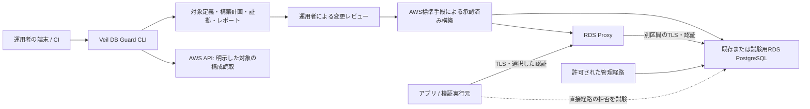

# 基本設計書

## 基幹設計への更新

2026-11-02、フィジビリティ確認を区切り、[DB接続保護の基幹設計](core/README.md)を次期製品構成の正本にしました。共通ポリシーから保護経路を準備し、アプリを段階移行し、不要な直通経路を閉じ、変更・失効・復旧までつなぎます。クラウドの配置先adapterとDB engine adapterを分離し、最初はGCP PostgreSQL、その後AWS PostgreSQLとMySQLへ展開します。

以下は既存AWS実装の設計と到達点です。「自動applyを含めない」は現行実装の範囲であり、次期基幹では承認済みtyped stepの限定executorを設計します。アプリ切替は初版では運用者のdeploymentへのhandoffです。[詳細契約](core/control-plane.md)と[実装順序](core/implementation-plan.md)を参照します。初回設計後、K01/K02とK03の導入graphを実装しました。[現在の利用範囲](core/local-usage.md)を参照し、全体設計を実装済みとは扱いません。

## 設計の状態

2026-11-02時点の設計です。AWS仕様の根拠と条件は [AWS調査](aws-findings.md)、実行契約は [詳細設計](detailed-design.md) に置きます。Rust実装とL層の確認は [ローカル検証記録](local-validation.md)、初期固定対象は [対象行列](support-matrix.md) を参照します。AWSでの成立確認は未実施です。

追加承認で[GCP接続保護の確認](gcp-cli.md)を実装しました。既存DBを守る導入運用の一段として、現在の接続事実と保護条件の充足を分け、反映確認待ちでもAllowedを隠しません。GCPの設定・adapter・評価はAWSのtarget型と分離し、新規run保存だけを共有します。GCPの構築適用・既存DB導入を完了したという意味ではありません。

## 全体構成

CLIは通常のDB通信を中継しません。実接続の検証は、対象VPCに到達でき、接続元の条件を特定できる実行環境で行います。ローカルファーストは、計画・解析・証拠保管を利用者側で行う方針です。インターネットからPrivate Proxyへそのまま接続できるという意味ではありません。

VPNやSSMポート転送等は経路ごとの特性を確認して選びます。トンネル経由の試験はトンネル終端側の接続元条件を検証するため、アプリからの直接接続の代わりにしません。初回のアプリ経路試験は同一検証ホスト上でアプリとCLIを実行する案です。

## 既存機能と自作部分

| AWS等に任せる部分 | Veil DB Guardが作る部分 |
| --- | --- |
| RDS/ProxyのDB通信・接続管理 | 対象と期待構成の明示、導入・変更・復旧計画 |
| IAM/DBユーザーによる認証、DB権限 | 認証方式の整合確認、試験用ユーザーと最小権限の設計 |
| SG、ルーティング、VPN等の経路制限 | 構成の読取・差分と、宣言した経路での実接続試験 |
| TLSと証明書発行 | 各区間の証拠整理、クライアントのCA/ホスト名検証 |
| AWSの構築/変更手段 | サンドボックス用テンプレートと既存環境向け変更計画の生成 |
| AWSのログ・イベント | 証拠の正規化、条件付きの判定、比較可能性の確認 |

## コンポーネントと依存方向

| 部分 | 責務 | 依存 |
| --- | --- | --- |
| `domain` | 設定・対象・証拠・判定の型と不変条件 | 外部APIに依存しない |
| `planner` | 期待状態と観測構成から変更計画を作る | domain |
| `aws_inventory` | 指定対象のAWS構成読取と取得失敗の記録 | domain、既存AWS CLI v2の限定adapter |
| `probe` | 宣言した試験のみ実行、DB後条件の確認 | domain、DBドライバー |
| `evaluator` | 証拠を要求に対応させ判定する | domain。ネットワーク操作なし |
| `report` | JSONと人向け表示、比較、秘密の除外 | domain |
| `cli` | 引数、許可範囲、期限、保存、終了コード | 上記を組み合わせる |

Rustの一つのcrate内で責務を分けました。独立crateやプラグイン機構は必要が生じてから検討します。AWS読取は既設CLIへ限定引数で委譲し、型付き応答を正規化します。選定理由と固定依存は [依存判断](dependency-decisions.md) とCargo.lockに記録します。

## 認証とTLS

認証モードは必須設定とし、自動で別モードへ切り替えません。

- 第一候補 `end_to_end_iam`: アプリ→Proxy、Proxy→DBの両方をIAM認証にする。対象リージョン・エンジン・バージョン・CloudFormation/SDK対応を固定してから採用する。
- 代替候補 `standard_iam`: アプリ→ProxyはIAM、Proxy→DBはSecrets Managerに対応するDB認証。採用する場合は秘密の管理・ローテーションと権限を設計へ追加する。
- 非対応の場合は適用外/未決として止め、黙ってパスワード方式へ降格しない。

アプリ→Proxyはクライアントのホスト名・CA検証を有効にします。Proxy側のTLS必須設定と、DB側のTLS強制・Proxy→DBの接続状態は別の確認事項です。Proxyの証明書とDBのRDS CAを混同しません。

## 許可経路

| 接続元 | 宛先 | 期待 |
| --- | --- | --- |
| 正規アプリの実行元 | Proxyの対象ポート | 許可。選択した認証/TLS/DB権限を要求 |
| 正規アプリの実行元 | DBの対象ポート | 拒否 |
| 認証を持たない検証元 | Proxy | 到達後に認証拒否。到達不能だけでは認証試験の合格にしない |
| 宣言した非許可接続元 | DB | 拒否。試した接続元・経路だけに結果を限定 |
| 許可された管理実行元 | DBまたは管理用Proxy | 明示した例外だけ許可。アプリ権限と分離 |
| デコイ | 本番DB/本番秘密 | 将来も不許可 |

複数SGの許可の合算、DB/Proxyの複数エンドポイント、IPv4/IPv6、管理・バッチ等の例外を対象情報に含めます。SGだけを読んでネットワーク全体を安全と判定しません。

## 構築と変更

`plan` は期待構成、現在の観測、未確認事項、差分、影響、復旧手順を出します。初期案では専用サンドボックス用CloudFormationを生成し、既存DBには変更計画を出します。利用者は内容・費用・対象を確認してAWS標準手段から適用します。CLIによる自動 `apply` は初期版に含めません。

サンドボックスのテンプレートは新規の専用試験資源のみを対象とし、既存DBの取り込み・置換・削除を含めません。既存DBへの導入では、アプリ設定、IAM、SG、DBユーザー、管理例外の変更順・段階移行・復旧条件を別途設計します。これはM4の作業です。

## 証拠と判定

構成情報・ローカル試験・AWS実接続・運用者の申告を別の証拠種別にします。判定は要求ごと、対象・接続元・時間範囲ごとに出します。`pass` は必要な証拠がそろった条件内だけに用い、総合的な「安全」のラベルは作りません。

未取得、アクセス拒否、タイムアウト、原因を特定できない接続失敗、対象の違う証拠は `unknown` です。既知の期待違反は `fail` とします。`not_applicable` は明示した対象範囲と理由がある場合に限定し、必須要求の不合格や未実施を隠すためには使いません。

## 安全性・障害・保管

- `inspect` は明示対象の読取専用。`probe` は明示的に有効化した試験だけ実行する。
- 試験用の書込は合成データ専用DB/スキーマと、専用ユーザーの許可がある場合に限定する。
- AWSプロファイル/ロールは既存の資格情報連鎖を使い、秘密を設定ファイルへコピーしない。
- 証拠にDB行、SQL値、トークン、パスワード、DSNを保存しない。AWS資源識別子等を含むローカル証拠の共有は別操作とする。
- 保存先は新規runディレクトリとし、既存証拠を上書きしない。中断や部分失敗でも状態を残す。
- 有限の接続/全体期限、並行数、再試行上限を設ける。認証拒否を無制限再試行しない。
- 最終レポートの整合性は再計算可能なmanifestで確認する。署名・改ざん耐性の保証とは扱わない。

## 設計判断と未決事項

| ID | 判断/問い | 現在の扱い | 解決先 |
| --- | --- | --- | --- |
| D01 | 中継プロキシを自作するか | 作らずAWS既存機能を利用する採用案 | M3で接続互換性を検証 |
| D02 | 初期言語と構成 | Rust、一つのcrate内で責務分割する採用案 | T02/T03 |
| D03 | 初期認証 | end-to-end IAMのみ実装。StandardIamは明示拒否。実AWS未検証 | T01完了、実証T16以降 |
| D04 | 対象のengine/version/region/instance class | PG16.15/東京へ固定。instance class・availability・費用は実験前に確認 | T01完了、実値T16 |
| D05 | 検証の実行元・AWSへの到達経路 | macOS ARM64/loopbackをローカル検証。同一アプリ経路の実Linux runnerは未決 | T01完了、実値T16 |
| D06 | 遅延/エラーの受入閾値 | 未決。測定前に利用場面と基準から決める | T16 |
| D07 | サンドボックス構築手段 | CloudFormation生成と別SQL bootstrap。ローカルschema検査、未適用 | T01/T12 |
| D08 | ライセンスと配布 | OSS方針のみ確定。具体的ライセンス/配布は未決 | T25 |
| D09 | 既存DBへ変更する運用・管理方式 | 未決。M4の導入先ごとに具体化 | T21 |

判断を変える場合は、この表と影響する詳細設計・検証・タスクを更新します。公開、課金、実環境変更は設計上の採用と別に承認を得ます。
