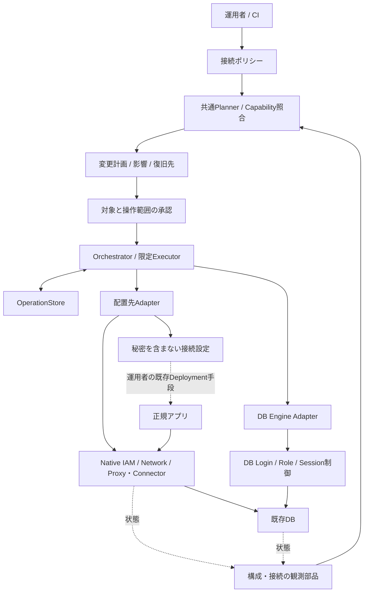

# DB接続保護の基幹設計

2026-11-03最終引継ぎ: [K10共通基盤のL受入とK11着手条件](k10-k11-handoff.md)を参照します。root probe/過去ログ/限定IAMの保証scopeを固定し、個別profileのUnknown・未対応は維持しました。その後、[K11-Aの詳細設計とprocess/socket部分実装](k11-a-runtime-binding-design.md)へ進みました。実session・認証・TLS・pool結合は未完了で、RuntimeBindingはUnknownのままです。以下は前チェックポイントの記録です。

2026-11-03継続更新: [管理TLS境界と拒否層の設計・実装](k10-trust-and-denial-design.md)へ進みました。旧厳密TLS契約と未対応範囲は維持します。以下は以前の設計・検証の記録です。

K10残producer更新: [GCP connect拒否・関連IAM/Pending・MySQL named ACL不在・AWS TLS観測限界](k10-producer-gaps.md)を参照します。限定profileを実装し、元の全provider/全拒否層要求の残差は維持します。

K10更新: [EC2 source・PG/MySQL取得とGCP/AWS実行接続](k10-native-source-execution.md)まで実装しました。A〜Fの初期接続が一巡し、sourceを確認した部分状態を評価・実行へ接続します。native拒否recipe、backend TLS/完全なIAM inventory、K11 runtime等の不足はUnknownとして残し、全profileの防御成立は宣言しません。実クラウド・SSH・DB操作は行っていません。

K09更新: 要求別の事前判定と、操作完了・保護未評価の区別を実装・ローカル検証しました。[現在の判定・CLI・残るK10の境界](k09-qualification.md)を参照します。追加フィジビリティ・実クラウド操作は行っていません。

設計照合: K01〜K08は限定した初期実装が一巡しています。全体設計には残作業があり、[現在地・根拠・次の基幹実装](design-implementation-audit.md)へ整理しました。K09の事前判定・根拠範囲と完了表示は実装・L検証済みです。現在の残差はK10の追加producerとK11以降です。

K08更新: PostgreSQLのGCP/AWS対応を維持し、既存AWS RDS MySQL 8.0.43／専用Proxyのアダプターを追加しました。[現在の組合せ・CLI・部分失敗と未確認の境界](k08-mysql.md)を参照します。実クラウド・実DBへの操作は行っていません。

K07更新: 既存RDS PostgreSQL／専用RDS Proxy向けのコードとローカル検証を追加しました。[現在の対応・操作・効果待ちの境界](k07-aws.md)を参照します。実AWS操作やworkload sourceに束縛した直通拒否の確認は行っていません。

K06更新: 状態評価、限定reconcile/recover、Deny更新、所有IAM/SQL差分の回収、DB login停止を実装・ローカル検証しました。[使い方・完了範囲・残る制限](k06-lifecycle.md)を参照します。cloud/実DBの操作は行っていません。

設計日: 2026-11-02。フィジビリティ確認を区切り、既存DBへ保護を導入し、維持・変更・回収できる製品の基幹を定義します。初回は設計文書と作業分割を作成し、以下を採用設計としました。

継続実装: K01〜K04に加え、依存整理とK05のGCP/PG native executor、限定SQL、binding/handoff、切替後の直通制限を実装し、ローカルで検証しました。単一クレートを維持し、coreからSQLite/provider/CLIへの依存を除去しています。[K05の現在地と制限](k05-native.md)を参照します。K06の限定lifecycleも実装済みです。実環境での適用と、旧Allowへ戻す補償は未確認・未実装です。追加フィジビリティ・クラウド操作は行っていません。

## 1. 目的と利用者の成果

既存の主要RDBMSを使う運用者が、DBや業務データを移し替えずに、正規アプリを認証された経路へ移し、不要な直接接続と不許可主体の接続を制限できるようにします。停止・処理中断の影響を明示した段階移行の順序と、問題が起きた場合の復旧先も製品の責務に含めます。

利用者は「DBごとにIAM、ネットワーク、DB role、接続設定を個別に組み立てる」作業を、アプリ・DB・許可条件の定義と、一つの変更計画にまとめられます。接続確認・証拠・レポートは、この導入と保護状態の維持を支える部品です。製品価値の仮説であり、導入実績や支払意思を確認済みとはしません。

長期目標は役立つ自分のプロダクトから持続的な収益を作ることです。基幹設計はそのための製品化へ進む判断であり、実験の追加や公開・販売の承認ではありません。

## 2. 採用する構成

共通control planeが接続ポリシーと変更の順序を管理し、実際の接続認証・経路制限・SQL権限はクラウドとDBのnative機能が実行します。

通常のSQL通信をVeilのcontrol planeへ通しません。初版はローカルCLIから操作を進め、常駐サーバーは必須にしません。CLI停止時にも、設定済みnative制御とアプリ側の接続・認証更新がnativeの契約に従って継続する構成です。

| 設計の判断 | 採用する内容 |
| --- | --- |
| 製品の中心 | ポリシーから保護経路を構築し、段階導入・変更・失効・復旧まで扱う |
| クラウドとDB | `DeploymentAdapter × EngineAdapter`の二軸。クラウド名でDB対応を一括判定しない |
| データ通信 | native Proxy/ConnectorとDB。独自のSQL wire proxyは初版の前提にしない |
| 変更の実行 | 承認済みtyped stepだけを実行する限定executor。任意shell/SQL hookは設けない |
| アプリの切替 | 初版は接続設定を生成し、運用者の既存deploymentで適用するhandoff。受領だけで稼働・保護成立とはしない |
| 永続化 | transactionalなローカルSQLite `OperationStore`を採用する設計。観測証拠のimmutable runとは分離 |
| 認証情報 | workload/native credential sourceと`SecretRef`。秘密値はpolicy・plan・journalに入れない |
| 承認 | 一つの計画に実行、許された再試行、限定repair、必要な補償の範囲を含め、stepごとに聞き直さない |
| 失敗時 | 既知の適用結果を保持し、結果不明は照合へ戻す。全体snapshotの上書きや直接経路の自動開放はしない |
| 継続運用 | 初版は明示的な`status/reconcile`。常駐監視や期限回収を導入済みと扱わない |

SQLiteは内部操作台帳の選択です。保護対象DBとしてSQLiteに対応したという意味ではありません。同梱版rusqliteとCargo.lock、rust-toolchain.tomlで実装環境を固定しています。

## 3. ポリシーから実効状態まで

入力は、対象DB、正規アプリ、管理・バッチ・復旧主体、接続元、経路、DB操作権限と制約です。共通ポリシーはnative設定を隠し切るものではなく、表現できない条件と共有影響を利用者へ返します。

例として「billing-appがconnector経由でbilling schemaの指定tableを読み書きできる。他主体と直接経路は許可しない。migrationは別identityと期限付き許可にする」と定義します。必要なrole・接続認可・networkの差分をまとめ、共有IAM bindingや共有DB userへ影響する場合は、その範囲も計画に表示します。未知のSQL権限を`GRANT ALL`へ広げません。

| 区別する状態 | 意味 |
| --- | --- |
| Desired | 運用者が適用したいポリシーrevision |
| Observed | 同じ対象・時刻・取得範囲における実構成と取得できなかった情報 |
| Operation | どのstepを実行し、providerが何を受理し、何が失敗・中断・結果不明か |
| Effective | 要求した効果ごとの成立・未成立・反映待ち・未確認と根拠 |

実行完了と保護成立を別に返します。IAM設定を変更できても、対象主体が現在接続できるなら、そのAllowedを保持します。Pendingはその事実を消しません。観測の鮮度が切れた後に、以前の状態を「現在保護中」と表示し続けません。

さらに、新規接続の停止、既存sessionの終了、SQL権限の縮小、credentialの取得・更新・回収は独立した効果です。新規接続を止められても、既存sessionが終わったとは報告しません。

型・状態機械・journal・再開の正本は[control plane詳細](control-plane.md)、native契約は[data plane詳細](data-plane.md)、失効・移行・復旧は[security lifecycle](security-lifecycle.md)です。

## 4. 最初に製品としてつなぐ範囲

初期profileを`gcp-cloudsql-postgres-connector-v1`とし、GCP Cloud SQL PostgreSQLから始めます。版付きprofileは設計上の契約です。現在の実測範囲はPostgreSQL 16.15/東京の専用環境であり、profile全体やproduction workloadの実装完了を意味しません。

| 項目 | 初期profileの決定 |
| --- | --- |
| 対象 | 登録した既存Cloud SQL PostgreSQL instanceと一つのアプリbinding。DB・業務データの移送は不要 |
| アプリのidentity | 専用workload identityと専用DB loginを対応付ける。運用者のgcloud認証やOwnerをアプリへ配布しない |
| 接続runtime | アプリと同じ保護された実行境界に置くAuth Proxyと、native IAM認証更新を利用する構成を第一候補として具体化。配置・driver/poolはbindingに固定する |
| ローカル境界 | Unix socketのアクセス権または同等のcontainer/process境界を明示。同一hostの全processを正規アプリとはみなさない |
| 実効制御 | Cloud SQL側のconnector必須化・接続認可・IAM DBログイン、PostgreSQLのSQL権限を組み合わせる |
| DB権限 | 明示したschema/object/operationへの限定role。既存共有accountからの分離も移行計画に含める |
| 管理・復旧 | アプリとは独立したidentityと承認済みconnector経路。native管理手順と必要権限をplanへ含める |
| アプリの切替責任 | 運用者が生成bindingをdeploymentへ反映し、pool/jobも切替。CLIはhandoff、受領、状態の対応を保持する |
| session終了 | 初期導入の必須効果へ暗黙追加しない。要求時は専用loginへの帰属・権限・対象粒度をcapability照合し、不足なら実行前に拒否する |
| 認証更新 | アプリruntime側のnative取得・更新へ委ねる。control planeは通常接続のtoken発行サービスにならない |

Auth Proxyはアプリ側runtimeです。Cloud SQLの認証・network・DBがenforcerであり、AWS RDS Proxyと同じserver-side構成にしません。更新integrationの具体的なdriver/配置・対応版は、そのbindingの実装時に固定します。

connector必須化はinstance内の既存clientへ広く影響します。直接接続している管理・batch・migrationも切り替えてから閉鎖します。「アプリだけ直通拒否、管理だけ同じ直接経路を維持」という矛盾した要求は、このprofileでは`CapabilityGap`にします。別profileを選ぶ場合は保護契約の違いを明示します。

接続元のnetwork条件とIAM主体は別です。CIDR/共有NAT/SGによる変更で主体一つだけを遮断できるとは限らないため、影響する全clientをplanのblast radiusへ含めます。

## 5. 導入・運用の順序

| 順序 | 利用者とVeilの動作 | 閉鎖・変更を進める条件 |
| --- | --- | --- |
| 1 登録 | DB世代、アプリ、管理・batch・復旧経路、変更禁止条件を登録 | 未登録経路と取得不足を運用者へ示す |
| 2 計画 | 現状から必要なidentity、role、runtime、network差分と復旧を生成 | capability、権限、影響、前提条件を満たす計画がある |
| 3 準備 | 承認された範囲で新保護経路と限定権限を準備 | 既存アプリの唯一の経路を先に閉じない |
| 4 切替 | bindingを渡し、運用者がアプリ・pool・jobを段階移行 | 申告と現在の接続状態を分け、切替の根拠と復旧先を保持する |
| 5 閉鎖 | 旧経路と不要な許可を限定して縮小 | 全clientへの影響と復旧経路を再照合する |
| 6 維持 | revision、差分、現在の実効状態、期限・未回収を表示 | repairは承認済みrecipeの条件内だけ。外部変更へ無条件追従しない |
| 7 失効・復旧 | 指定効果で主体を失効、必要なら独立経路で復旧 | 新規接続・session・SQL権限・credentialの結果を別々に保持する |

実装するCLI namespaceは`guard`を予定します。現行の`plan/inspect/probe/report`、`gcp check/report`は互換な下位機能として残し、その型を新policyへ無理に転用しません。

| 設計するコマンド | 責務 |
| --- | --- |
| `guard plan` | policyと取得状態からimmutableなChangePlanを作成 |
| `guard apply` | 対象・plan hash・期限・scopeに結び付いた承認でstepを進める。handoff地点では安全に中断できる |
| `guard status` | desired/observed/operation/effective、残存session・例外・鮮度を表示 |
| `guard reconcile` | 現状を再照合し、承認済みrepairだけを適用。変更scopeが増える場合は新planへ戻す |
| `guard revoke` | 指定主体の停止効果と影響を計画し、承認内で実行 |
| `guard recover` | journalと現状から、中断再開・限定補償・復旧を進める |

上表は目標のoperation名です。実装済みは`guard plan/approve/begin/resume/status/cancel/revoke-approval`、`state/binding/attest`、限定nativeの`apply-gcp/apply-aws`とAWS metadata読取の`inspect-aws`です。native適用・読取は明示opt-inへ接続し、通常の`resume`はローカルのみです。`reconcile/revoke/recover`は限定計画を作り、新しい承認後に配置先のapplyコマンドで実行します。recoverは現在desiredの修復で、旧Allowへ戻すrollbackではありません。statusは現在のライブ保護を再検査するコマンドではありません。

## 6. ソースの責務と再利用

まず現在の一つのRust crate内へ追加します。将来用のplugin ABI、複数service、汎用workflow engineは先行導入しません。

| 提案する境界 | 所有する責務 | 既存コードとの関係 |
| --- | --- | --- |
| `core/policy` | target、subject、grant、profile、revision、不変条件 | 既存AWS/GCP configと別schema |
| `core/capability` | 効果・対象粒度・前提・保証段階とgap | adapter名だけで対応判定しない |
| `core/plan` | typed step DAG、precondition、diff、承認scope、復旧recipe | 既存`planner`のCFN生成は必要な部分だけ下位化 |
| `core/operation`と`core/orchestrator` | step実行、結果不明照合、handoff、再開・補償 | 現行probeの処理完了と別に管理 |
| `core/state` | desired/observed/effectiveの集約と鮮度 | GCPのAllowed/Pending/Unknown契約を維持 |
| `operation_store` | SQLite transaction、target lease、journal、schema移行 | 既存`store::RunWriter`を上書きしない |
| `adapters/deployment` | GCP/AWS等のidentity/network/runtime/native操作 | 現行`gcp`と`aws_inventory`をまずread-only bridgeで再利用 |
| `adapters/engine` | PostgreSQL/MySQL等のDB identity、権限、session | driver・SQL差分をDBごとに所有 |
| `binding` | アプリへ渡す設定・identity/credential source・切替情報 | runtime管理とcontrol planeを分離 |
| `cli`統合 | policy/plan/承認/operationの入出力 | 主担当が`main.rs/lib.rs/Cargo`の変更を統合 |

依存はCLI→core→adapter interfaceとstore interfaceです。coreへgcloud/aws/SQL文字列を埋め込みません。adapter実装はtyped操作だけを受け、provider情報を共通状態へ正規化します。

## 7. 他DBへの拡張と今回の区切り

AWS PostgreSQLもK07で限定実装しました。K08では同じ操作モデルを再利用し、RDS MySQL 8.0.43のengine adapterとbindingを追加しました。実導入と他の版・配置先は未確認です。MariaDB、SQL Server、Oracle、自己管理環境も構想に残します。各組合せでnative経路・認証・権限・失効粒度を宣言し、全DBに同じIAM方式を要求しません。D1/embedded SQLite等はAPI/file境界を持つ別の接続形態として扱います。

I28の隔離デコイとI29の継続防御は、target、event、policy revision、reconcileを拡張点として保持します。初期I27の導入機能を完成させる前提条件にはしません。

K01〜K08に続きK09を実装・L検証しました。K10の初期source/実効評価/実行接続は一巡し、[設計照合](design-implementation-audit.md)と[タスク一覧](../tasks.md)へ追加producer/K11以降の残差を示しています。追加のフィジビリティ試験を開始条件へ加えません。既存AWS検証系列の未完了を、次のローカル基幹実装の開始条件へ戻しません。基幹実装、具体的な導入先変更、公開はそれぞれ区別します。
