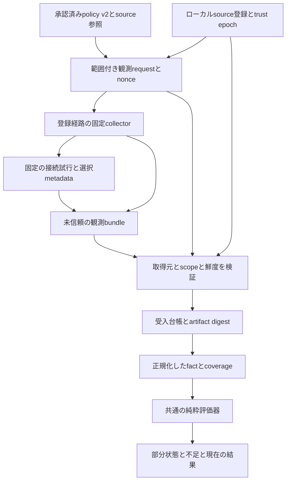

# K10 基本設計：取得元を検証した証拠と現在の実効状態

2026-11-03更新。[EC2 source・PG/MySQL取得とGCP/AWS実行接続](k10-native-source-execution.md)を実装・ローカル検証しました。A〜Fの初期接続が一巡し、AWS sourceは独立したidentity/channelから受け入れます。GCP PGとAWS PG/MySQLは`source-bound-execution-v3`契約で変更前/後を分け、旧v1/evaluation-v2の読取・hash・承認の意味は維持します。新契約には再plan/再承認が必要です。native拒否・backend TLS・完全なinventory等が残り、全体保護の成立やK10全条件の完了とは区別します。実クラウド・SSH・DB操作や追加フィジビリティ試験は行っていません。

詳細契約は[証拠・評価契約](k10-evidence-contract.md)、実装単位・受入条件は[作業設計](k10-work-plan.md)を正本とします。Aの実装済み型・offline policy v2は実装記録を参照します。Cの初期collector/verifierとB受入は内部APIとして実装済みです。DのPG producer・現在評価も内部APIとして実装しました。利用者向けobserve/state/statusは[E/Fの進捗](k10-ef-observation-cli.md)で追加しました。

## 1. 今回固定する結論

目的は、既存DBを守る導入・失効操作に、**登録した対象・主体・送信元・経路についての現在状態**を接続することです。単にUnknownを減らすことを目標にしません。

| 決定 | 採用する内容 |
| --- | --- |
| 全体構成 | 単一Rustクレート・単一CLIのモジュラーモノリス。通常SQLの中継はnative機構のまま |
| 最初のDB | GCP Cloud SQL PostgreSQL 16.15／asia-northeast1、既存のconnector profile。続いてAWS PostgreSQL、最後にMySQLへ共通契約を適用 |
| 最初のsource profile | `gce-host-network-v1`。既存Compute Engine Linux VMの登録済みhost network境界を対象とする設計。VMの存在・利用権限は未確認で、新設を前提にしない |
| sourceの意味 | VMのnetwork境界と、その境界で試した明示route。個別app PID／container／poolの稼働証明とは区別 |
| 取得方式 | 登録済みSSH host keyを検証した経路から、固定の単発collectorを呼ぶ。常駐Veil serviceや任意shell/SQL hookを追加しない |
| 信頼する範囲 | ローカル操作者・OS・承認台帳、登録sourceの管理者・OS、固定collector、検証に使うproviderの認証応答。appがcollectorを改変できる構成は受け入れない |
| 証拠の入口 | wireの申告をverifierで検証し、同一ローカル台帳へ受入記録を保存。manifest/hashや自己署名だけを真正性にしない |
| version | source参照を固定するpolicy v2、証拠bundle v1、明示した評価契約v2を追加。既存policy／state v1を自動変換しない |
| 部分完了 | source、TLS区間、SQL、binding等の不足を個別表示。全必須条件が揃わなければ全体保護完了にしない |

最初のsource profileの選択は、実装可能な契約へ具体化するための範囲決定です。GKE／Cloud Run／container／AWS VM／他OSを製品構想から除外しません。異なる実行環境の証明方法を同じVM証拠へ押し込めず、個別profileへ追加します。Linux動作やsource確認を実証済みとは表示しません。

## 2. 既存コードから分かった変更点

| 現在のコード | K10で必要な変更 |
| --- | --- |
| `core/policy.rs`のsourceは文字列IDの参照 | IDが指す登録・世代・境界のdigestをpolicy v2へ固定。登録差替えで古い承認を流用させない |
| `StateEvidence.identity_confirmed`は単一bool | target／principal／source／route／TLS／時間の確認根拠を別々に保持し、必要条件を満たす証拠だけ評価へ渡す |
| `desired_for_change`はDenyの接続層をConnectionAuthorizationへ固定 | 要求する停止効果と、実際に拒否した層を分離。IAM必須の要求をDB login拒否で代用しない |
| TLSはdesired行に独立して表れない | VerifiedTlsの各区間を必須条件へ加える。SSL使用だけと、CA／hostname検証済みを分ける |
| source／routeを含むscopeの完全一致でcontrolを参照 | 正例controlが何を裏付けるかを限定。別sourceの成功で負例sourceのnetwork到達性を証明しない |
| build IDが一つで、取得側と評価側の違いを表せない | collector build・verifier build・評価契約IDを分け、許可した組合せだけ受け入れる |
| 所有SQL deltaの回収receiptと、現在の実効権限は別経路 | owned delta absentとeffective privilege absentを別factとして扱う |
| 手動binding checkpointがある | 配布・切替の申告を保持し、実runtime bindingの観測へ自動昇格させない |

K09で追加した静的qualification、受付済みqueryと新規writeの分離、source未確認を全主体へ展開しない条件は維持します。

## 3. 信頼境界とデータの流れ

Source Registryは証拠を正しいと宣言するファイルではありません。どのrunnerをどの境界の検証対象として認めるかという信頼設定です。変更には新しい登録revisionを付け、参照するpolicyを更新・再承認します。collectorの自己申告だけで登録を作成・更新しません。

最初のhost keyとVMの対応は、信頼する操作者が既存の管理経路で確認して登録するbootstrapです。同じ未認証接続で発見した鍵をそのまま信頼する方式にはしません。登録後も、channel・native identity・contextの実確認を省略しません。

RunWriterは整合性保存を担い、Evidence Admissionはどのverifierが何を確認したかを記録します。copyしたbundleを別マシンへ持ち込んだだけでは、そちらの受入台帳へ確認済みとして登録しません。同一OSユーザーがCLI・台帳自体を自由に改変する脅威への耐改ざん保証は、現行のlocal-first承認モデルと同様に範囲外です。

## 4. 最初のsourceの確認手順

`gce-host-network-v1`は、次の条件を**すべて**満たしたときだけVM network境界を確認済みとします。

1. source registrationに、project／zone／不変instance ID／作成時刻、SSH host key、collector build・配置・実行user、許可する主体とtarget、host network境界を固定する。
2. controllerは専用known-hostsと固定SSH設定を使い、未知・変更済みhost key、暗黙のProxyCommand／転送／接続共有を拒否する。入力をremote commandへ展開せず、固定collectorへboundedなtyped requestをstdinで渡す。
3. collectorから受けたGoogle署名のfull instance identity tokenをmemory内で検証する。issuer、許可alg/key、audience、期限、VMとSAの識別情報を登録へ照合する。audienceはrequest nonceとrequest digestに束縛する。
4. 同じ認証済みchannel上の固定collectorが、登録したnetwork境界・実行contextで試行したことを確認する。別namespace、未登録proxy／tunnel、UID等で変わるegress条件を区別できなければ、sourceを確認済みにしない。
5. DB用資格情報は、そのsourceの許可されたnative credential sourceから取得し、固定principalへ照合する。controllerの管理・復旧credentialをapp VMへ転送しない。初期profileはVMのSAと許可app principalの対応、metadata経由の取得に限定する。環境変数・ADC file・操作者のgcloud accountへ暗黙fallbackしない。
6. 実際の接続先hostname、解決IP／address family、local/peer tuple、TLS・DB user／database、時刻を試行へ結び付ける。管理側で確認したtarget generation／route metadataとの前後整合も確認する。

Googleのfull identity tokenはaudienceとVM識別情報を含みます。これはVM identityを検証する部品です。tokenだけからアプリprocessやnetwork経路まで証明できるとは解釈せず、上記channel・collector・登録contextを合わせる設計とします。[Googleの一次資料](https://docs.cloud.google.com/compute/docs/instances/verifying-instance-identity)

SSHのhost key厳格確認は登録相手への接続確認に使います。任意コマンドを実行できるProxyCommand等を既定設定から持ち込まないよう、専用設定と明示optionを固定します。[OpenSSHの一次資料](https://man.openbsd.org/ssh_config)

固定collectorの導入・権限設定は、利用者がレビューするdeployment作業です。観測commandから自動install／sudo／VM変更をしません。必要条件がない場合は`SourceUnavailable / ContextUnverified`で止まり、別hostの結果で埋めません。

## 5. 管理・復旧の独立性

app sourceとrecovery sourceは独立登録・独立credentialのままです。正例controlのために管理credentialをapp sourceへ持ち込むことを禁止します。

source-Aの正例はsource-Bのnetwork到達性を証明しません。一方、source-BでCA／hostnameを検証した同一targetのDB応答を既に取得できている場合は、別recovery sourceの正例を「同時刻近傍のtarget健全性」の補助に使えます。何を裏付けたcontrolかを型で保持し、source証明とは別に評価します。詳細条件は[契約](k10-evidence-contract.md)で固定します。

## 6. K10で提供する結果と区切り

K10は、取得したproofの範囲で現在Allowed、原因を確認したDenied、SQL権限、TLS、未確認のbinding、有限Pendingを一つのreportへ結びます。全必須条件が揃ったscopeだけを成立にできます。未知のroute・source・TLS区間があればcoverage不足を残します。

手動handoffしかないappの実binding／pool切替は、K11のruntime連携がない限り確認済みにできません。SQLの先在権限が残る場合も同様です。**K10の実装完了と、特定の導入先の全profileが緑になることは別です。** 不足を隠して全体完了にする変更はしません。

session選別終了、期限自動回収、共有accountからの自動移行、監視daemon、全送信元・全迂回経路の不存在証明は追加しません。対象外をcapability／coverageへ残し、元の主要RDBMS構想は維持します。
