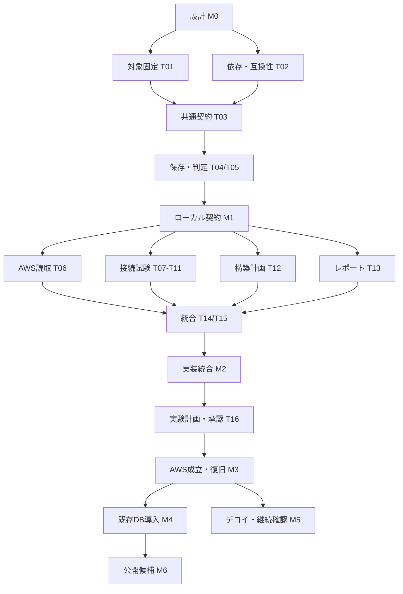

# マイルストーン

K11更新。Unix peer観測、GCP PostgreSQL管理poolの世代切替、証拠受入の照合契約と復旧gate、AWS PostgreSQL/MySQLのアプリ接続をローカル検証しました。実アプリ接続のIAM/TLS・pool利用を独立して確認する資料が揃うまでRuntimeBindingはUnknownです。[実装・検証範囲](core/k11-work-plan.md#unix-peerpool切替受入の接続)

K11-A更新：詳細設計とprocess/socket部分の生成・受入・共通state接続をローカル検証しました（652成功・実DB2件ignored）。[証拠と未完了の境界](core/k11-a-runtime-binding-design.md#10-今回のローカル検証結果)を参照します。完全なRuntimeBindingはB/Cの実session・pool結合待ちです。

2026-11-03最終引継ぎ: [K10共通基盤のL受入とK11着手条件](core/k10-k11-handoff.md)を参照します。root probe/過去ログ/限定IAMの保証scopeを固定し、個別profileのUnknown・未対応は維持しました。その後、[K11-Aの詳細設計とprocess/socket部分実装](core/k11-a-runtime-binding-design.md)へ進みました。実session・認証・TLS・pool結合は未完了で、RuntimeBindingはUnknownのままです。以下は前チェックポイントの記録です。

2026-11-03継続更新: [管理TLS境界と拒否層の設計・実装](core/k10-trust-and-denial-design.md)へ進みました。旧厳密TLS契約と未対応範囲は維持します。以下は以前の設計・検証の記録です。

2026-11-03追記: [残producerの実装と観測限界](core/k10-producer-gaps.md)でGCP connect拒否・限定完全IAM/Pending・MySQL named ACL不在を共通stateへ接続しました。AWS backend CA/hostname証拠など元の要求の残差は維持し、K10全完了とは扱いません。以下は前チェックポイントの記録です。

[EC2 source・PG/MySQL取得とGCP/AWS実行接続](core/k10-native-source-execution.md)を実装・ローカル検証しました。K10-A〜Fの初期接続が一巡し、新契約で変更前/後のsource証拠を分けます。native拒否・backend TLS・完全なinventory、K11 runtime等の不足は残り、K10やC系列全体の完了・実環境の防御成立とは区別します。

日付や開発日数は未見積です。対象・依存・未知を減らしてから見積もります。各到達点は技術成果として評価し、利用者価値・公開可否と分けます。

## 現在の基幹設計系列

K10は[作業設計](core/k10-work-plan.md)のA〜D初期範囲に、E/E2のEC2 source・PG/MySQL取得とF/F2のGCP/AWS source-aware実行を接続しました。旧評価専用v2承認を流用せず、再plan/再承認と現在証拠が必要です。残差は[タスク一覧](tasks.md)のnative拒否・TLS/IAM inventory、K11 runtime等へ明示しています。

K01〜K08の初期コード・ローカル検証は一巡していますが、C系列の全体設計条件をすべて満たした状態ではありません。[設計照合](core/design-implementation-audit.md)と[K09以降の作業](tasks.md)に、要求別事前判定・source帰属・共通effective・導入/補償の残差を記載しました。K09は実装・L検証済みで、次の未完了はK10です。

GCPフィジビリティとCLI実機確認を区切り、追加試験をせず基幹設計へ移りました。製品化の次の順序はC系列です。詳細な完了条件と担当作業は[基幹実装計画](core/implementation-plan.md)に置きます。

| ID | 到達点 | 対応タスク | 現在 |
| --- | --- | --- | --- |
| C0 | 共通ポリシー、二軸adapter、導入・維持・失効・復旧の基幹設計 | K00 | 完了（設計・分担レビュー） |
| C1 | 共通policyとcapabilityが使える | K01,K02 | 完了（L、既存観測とのoffline bridge） |
| C2 | 変更計画、限定承認、操作台帳、中断再開がつながる | K03,K04 | 初期基盤実装済（common kernel・台帳port・ローカル注入driver・CLI）。要求別qualificationはK09で実装・L検証済み |
| C3 | GCP PostgreSQLへ保護経路を導入し、アプリ切替と旧経路閉鎖を扱える | K05 | 実装・L検証済。実導入未確認、timeoutのみでは効果待ち |
| C4 | 保護の維持・失効・復旧を効果ごとに扱える | K06 | 初期対応を実装・L検証済。session/JIT自動回収・実導入は未確認/未実装 |
| C5 | AWS PostgreSQL、次にMySQLへ拡張できる | K07,K08 | AWS PGはK07、AWS MySQLはK08で実装・L検証済。実導入は未確認 |

C系列の開始に、旧AWS M3の追加実験は要求しません。C4の状態・維持・失効・限定復旧までコードとローカル検証を進めました。[K05の制限](core/k05-native.md)を明示し、production導入・公開の完了とは分けます。以下M系列は過去のAWS計画と実装記録として条件を保持し、未完了を完了へ変更しません。

## 既存AWS系列

| ID | 到達状態 | 依存 | 完了条件 | タスク | 現在 |
| --- | --- | --- | --- | --- | --- |
| M0 | 設計と実行可能な作業計画がある | なし | 要求→設計→検証→タスクが追跡でき、共通契約・分担・未決・承認境界を記載。文書整合と独立レビュー完了 | T00 | 完了（文書確認） |
| M1 | ローカルの共通契約が使える | M0、実装着手の合意 | 対象と依存を固定し、設定/証拠/判定契約と保存処理が動く。V01/V04/V05/V14の対象部分をfixtureで確認 | T01〜T05 | 完了（ローカル契約） |
| M2 | 構築計画とAWS読取・接続試験器が統合される | M1 | CLI、AWS adapter、probe、plan、reportがつながる。ローカル/adapter fixtureの重要正常・異常系、秘密非出力、対象限定を確認。AWS未検証と表示 | T06〜T15 | 主要実装・L検証済／一部未実装 |
| M3 | AWSサンドボックスで接続防御が成立する | M2、対象別のクラウド実験承認 | V02/V03/V06〜V16/V21の計画対象を実施（V14は同一buildのローカル秘密非出力試験を別欄で要求、他はAWS）。正規経路、認証/TLS拒否、直接迂回拒否、管理、再接続/復旧を実証。性能と片付け後に最終profileを評価。必須項目のunknownなし | T16〜T20 | 未承認・未着手 |
| M4 | 既存DBを置換せず導入・復旧できる | M3、導入先別承認 | 既存クライアント/管理/バッチ等を棚卸しし、段階導入・切戻しとV17/V22を確認。M3の結果を導入先の証明に流用しない | T21,T22 | 未承認・未着手 |
| M5 | デコイと継続確認が機能する | M2/M3と対象別設計・承認 | I28の隔離/既知試行/通知、I29のドリフト/証拠失効/再確認をV18〜V20で確認。二つの枝の結果を個別に記録 | T23,T24 | 将来構想 |
| M6 | 公開候補の範囲と証拠が揃う | M4。M5機能を含めるならその実証も必要 | サポート条件・導入/復旧手順・未検証範囲・ライセンス/依存帰属・公開物の秘密確認が揃い、公開内容をレビューできる | T25 | 未着手 |

M6は公開準備の到達点です。push、リリース、配布の実行には具体的な公開承認が必要です。初期のI27中心のOSS公開候補と、I28/I29を含む最終構想の達成は区別します。将来機能を未実装と正確に表示する場合、M5全体を初期ソース公開の必須条件にはしません。

## 依存と並列化

M2では独立した作業を並列にできますが、主担当＋最大2担当程度から始める案です。同時に扱う作業設計書を絞り、共通型・Cargo設定・CLI統合は主担当が所有します。AWS環境の構成変更や障害注入は一つの実行計画の管理下で直列に行います。

## 中断・方式変更の条件

- 選択したengine/region/認証方式が非対応なら、対応する組合せまたは明示した標準IAM方式を検討し、T01の判断を更新する。
- driver機能や既存SQLがProxyと非互換なら、影響する利用場面を限定し、設定/driver/SQL変更の可否を判断する。全DB構想の不可能とはしない。
- 必要な実験環境や承認がない場合、ローカル成果と実験計画を残してM3を待つ。代替試験をAWS実証に読み替えない。
- 費用/時間上限、安全条件、対象同一性に反した場合は実行を停止し、取得済み証拠と残資源を報告する。
- 利用者の不便が減らない場合は、どの手順・対象で価値が不足したかを確認し、導入体験や提供範囲を修正する。
